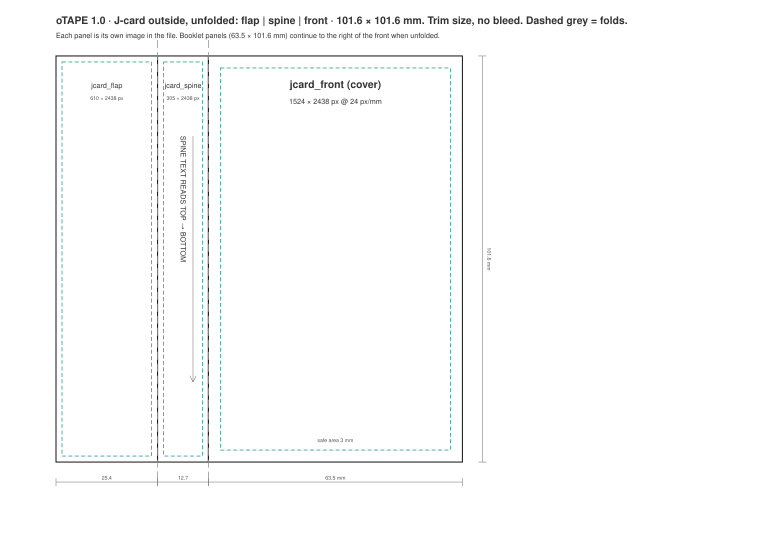

# oTAPE File Format Specification

**Version 1.0** · Status: Release Candidate · 2026-10-29
**Author and editor:** Jan Osio · **Repository:** <https://github.com/otape-studio/otape-spec>
**File extension:** `.otape` · **Media type:** `application/vnd.otape.cassette` · **Apple UTI:** `org.otape.cassette`

> oTAPE is an open digital cassette format.
> A cassette is not just audio. It is audio, sides, artwork, packaging, protection and memory.

---

## Contents

1. [Introduction](#1-introduction)
2. [Conventions and terminology](#2-conventions-and-terminology)
3. [Container](#3-container)
4. [Identification](#4-identification)
5. [Cassette model](#5-cassette-model)
6. [Manifest](#6-manifest)
7. [Sides and audio](#7-sides-and-audio)
8. [Write protection](#8-write-protection)
9. [Recording](#9-recording)
10. [Appearance](#10-appearance)
11. [J-card and case](#11-j-card-and-case)
12. [Artwork](#12-artwork)
13. [History](#13-history)
14. [Medium state and local state](#14-medium-state-and-local-state)
15. [Versioning and extensibility](#15-versioning-and-extensibility)
16. [Conformance](#16-conformance)
17. [Security considerations](#17-security-considerations)
18. [Reference material](#18-reference-material)
- [Appendix A: Changes from the 1.0 draft](#appendix-a-changes-from-the-10-draft)
- [Appendix B: Geometry reference](#appendix-b-geometry-reference)
- [Appendix C: Reading an oTAPE file step by step](#appendix-c-reading-an-otape-file-step-by-step)

---

## 1. Introduction

oTAPE stores **one cassette** in **one file**. The file is a portable object you can own, lend, record over,
protect, flip and collect, the digital equivalent of a compact cassette in its case.

An `.otape` file contains:

- the recording on **side A** and on **side B**, each one continuous take;
- the cassette's **identity and metadata**;
- the **look of the cassette**: plastic shell, label, lettering;
- the **paper**: J-card cover, spine, back flap and an optional fold-out booklet;
- optional **track markers**, notes, dedication and **history**.

### 1.1 Design principles

1. **A cassette is not a playlist.** Each side is one continuous recording. Silence between songs, spoken
   intros and the click of a pause button are part of the recording.
2. **Physical behaviour is preserved.** A cassette has a fixed length, two sides that share one tape, a
   position you reach by winding, and a record tab that can be broken off.
3. **The file is the object.** It is self-contained and works offline. It never refers to the files that were
   recorded from.
4. **Listening does not change the object.** Playback position, ratings and library data stay with the player,
   not in the file.
5. **Open and simple.** A ZIP container, one JSON manifest, standard audio and image formats. A developer can
   write a basic player in an afternoon.
6. **Distinctive by design.** Every cassette can look unique, either with images in fixed physical
   proportions or with a compact procedural description any player can draw.

### 1.2 Non-goals

oTAPE is not a DRM system, not a streaming format and not a multitrack audio container. It does not describe
how a player's user interface must look.

---

## 2. Conventions and terminology

The key words **MUST**, **MUST NOT**, **REQUIRED**, **SHOULD**, **SHOULD NOT**, **RECOMMENDED**, **MAY** and
**OPTIONAL** are to be interpreted as described in RFC 2119 and RFC 8174 when, and only when, they appear in
all capitals.

| Term | Meaning |
| --- | --- |
| **Cassette** | One oTAPE object, i.e. one `.otape` file. |
| **Side** | `A` or `B`. Each side is one continuous recording on the same tape. |
| **Side length** | Playing time of one side in seconds, fixed by the cassette type (`side_length_seconds`). |
| **Timeline** | The frame grid used for all positions in a cassette, at `timeline_rate` frames per second. |
| **Frame** | One sample instant on the timeline (one sample per channel). |
| **Recorded length** | `recorded_frames`: the high-water mark of recording on a side. Everything after it is blank tape. |
| **Head position** | Where the tape is, as a frame offset from the start of the current side. |
| **Reader** | Software that opens oTAPE files. **Player**, **recorder** and **editor** are kinds of reader ([§16](#16-conformance)). |
| **Writer** | Software that creates or modifies oTAPE files. |
| **mm** | Millimetres. All physical sizes in this document are in millimetres. |

JSON terms (object, array, string, number, `null`) are as in RFC 8259. Paths are archive paths ([§3.3](#33-paths)).

---

## 3. Container

### 3.1 ZIP

An `.otape` file is a ZIP archive (PKWARE APPNOTE 6.3.x).

- Entries **MUST** use the *stored* (0) or *deflate* (8) compression methods.
- Entries **MUST NOT** be encrypted.
- ZIP64 extensions **MAY** be used and readers **MUST** support them.
- File names **MUST** be UTF-8 (general purpose bit 11 set, or ASCII only).
- Audio and image entries **SHOULD** be *stored*, since they are already compressed. A stored entry can be
  read or streamed in place.
- The archive **MUST NOT** contain symbolic links. Directory entries are optional and ignored.

### 3.2 The `mimetype` entry

Writers **MUST** write an entry named `mimetype`:

- as the **first entry** of the archive,
- **stored** (no compression), with no extra field,
- containing exactly the 30 ASCII bytes `application/vnd.otape.cassette`, with no line break.

This puts the media type at a fixed offset (byte 38) of the file, so tools can recognise an oTAPE file without
unzipping it. EPUB and OpenDocument use the same technique. Readers **SHOULD NOT** reject a file because
`mimetype` is missing or not first. The manifest is authoritative.

### 3.3 Paths

Every path in the manifest refers to an entry in the same archive and **MUST**:

- be relative (no leading `/`), use `/` as separator and contain no `\`;
- contain no `.` or `..` segment;
- not be `mimetype` or `manifest.json`.

Paths are case-sensitive. Writers **SHOULD** use lowercase ASCII paths.

### 3.4 Layout

```
example.otape
├── mimetype                    REQUIRED  first entry, stored
├── manifest.json               REQUIRED  the cassette (§6)
├── audio/
│   ├── side-a.m4a              REQUIRED if side A has been recorded on
│   └── side-b.m4a              REQUIRED if side B has been recorded on
├── artwork/                    OPTIONAL  images (§12)
│   ├── cassette-face-a.png
│   ├── cassette-face-b.png
│   ├── label-a.png
│   ├── label-b.png
│   ├── jcard-front.png         (or .jpg)
│   ├── jcard-spine.png
│   ├── jcard-flap.png
│   ├── booklet-01.png …        booklet panels in reading order
│   └── thumbnail.png
├── docs/                       OPTIONAL  booklet.html, notes.md (§12.7), license.txt (§6.4)
└── extras/                     OPTIONAL  implementation data (§15.3)
```

The names under `audio/` and `artwork/` are **RECOMMENDED** names. Readers **MUST** use the paths given in the
manifest and **MUST NOT** guess a file from its name.

### 3.5 Limits

| Item | Limit |
| --- | --- |
| `manifest.json` | **MUST NOT** exceed 1 MiB. |
| Image | **MUST NOT** exceed 8192 px on either side and **SHOULD NOT** exceed 32 MiB. |
| Booklet panels | **SHOULD NOT** exceed 32. |
| Archive entries | **SHOULD NOT** exceed 1024. |

Readers **MAY** refuse files that exceed these limits.

---

## 4. Identification

| | Value |
| --- | --- |
| Format name | **oTAPE** (written with a lowercase *o*) |
| File extension | `.otape` |
| Media type | `application/vnd.otape.cassette` (intended for IANA registration) |
| Apple Uniform Type Identifier | `org.otape.cassette`, conforming to `public.data`, `public.content`, `public.zip-archive` |
| Magic | `PK\x03\x04` at offset 0 and `application/vnd.otape.cassette` at offset 38 ([§3.2](#32-the-mimetype-entry)) |

Applications that own the format **SHOULD** register the extension with their platform's document-type
mechanism. On Apple platforms that is `UTExportedTypeDeclarations` plus `CFBundleDocumentTypes`.

---

## 5. Cassette model

### 5.1 Cassette types

| `type` | `side_length_seconds` | Minutes per side |
| --- | --- | --- |
| `C46` | 1380 | 23 |
| `C60` | 1800 | 30 |
| `C90` | 2700 | 45 |
| `C120` | 3600 | 60 |
| `custom` | 1 … 5400 | any, up to 90 |

For the standard types `side_length_seconds` **MUST** equal the value in the table. Readers **MUST** reject a
mismatch. A `custom` cassette is labelled like a real one, with its total length in minutes rounded:
`C` + round(2 × `side_length_seconds` / 60), e.g. 37 minutes per side → **C74**.

### 5.2 Identity

| Field | Rule |
| --- | --- |
| `cassette.id` | **REQUIRED.** RFC 4122 UUID, lowercase recommended. Identifies this cassette. A writer **MUST** generate a new id for a new blank cassette and for a dub ([§13.2](#132-event-types)). Copying the file does not create a new cassette. |
| `serial_number` | Optional collector's number chosen by the creator, e.g. `OT-000001`. Not guaranteed unique. |
| `created_at` | **REQUIRED.** RFC 3339 timestamp, UTC recommended (`2026-10-28T22:00:00Z`). |
| `created_with` | Name and version of the creating application. |

The id is an identity, not a protection mechanism. Two copies of a file are the same cassette.

### 5.3 Timeline

All positions and lengths in a cassette, including `recorded_frames`, marker `frame`, history `start_frame`
and `end_frame`, are integers on one timeline:

- `cassette.timeline_rate` is **44100** or **48000** frames per second. Default: **44100**.
- The side length in frames is `side_length_seconds × timeline_rate`.

Using integer frames instead of seconds makes positions exact. A recording and the silence after it line up to
the sample.

### 5.4 Head position and flipping

Both sides share one physical tape. A head position *p* frames into side A is the same piece of tape as
*L − p* frames into side B, where *L* is the side length in frames.

Players that simulate flipping **SHOULD** apply this mapping: at the end of side A you flip to the start of side
B. Players **MAY** instead keep independent positions per side if they don't simulate the tape physically.

### 5.5 Blank tape

Any part of a side that has never been recorded is **blank tape** and plays as silence. This includes every
frame from `recorded_frames` to the end of the side, and all of a side whose `audio` is `null`. Players
**MAY** render blank tape with a faint tape hiss.

---

## 6. Manifest

`manifest.json` is a UTF-8 JSON document without a byte-order mark. Its root is an object.

### 6.1 Top level

| Key | Type | Req. | Description |
| --- | --- | --- | --- |
| `format` | string | **yes** | Always `"oTAPE"`. |
| `format_version` | string | **yes** | `"MAJOR.MINOR"`, `"1.0"` for this document ([§15](#15-versioning-and-extensibility)). |
| `cassette` | object | **yes** | Identity and metadata ([§6.2](#62-cassette)). |
| `sides` | object | **yes** | Exactly the keys `"A"` and `"B"` ([§7](#7-sides-and-audio)). |
| `appearance` | object | no | Procedural look of shell and label ([§10](#10-appearance)). |
| `jcard` | object | no | Text and colours of the paper insert ([§11](#11-j-card-and-case)). |
| `artwork` | object | no | Image slots ([§12](#12-artwork)). |
| `booklet` | object | no | Fold-out panels and documents ([§12.7](#127-booklet-and-documents)). |
| `history` | array | no | Events in the cassette's life ([§13](#13-history)). |
| `extensions` | object | no | Implementation data ([§15.3](#153-extensions)). |

All keys use `snake_case`. Side keys are the uppercase letters `"A"` and `"B"` everywhere they appear.

### 6.2 `cassette`

| Key | Type | Req. | Description |
| --- | --- | --- | --- |
| `id` | string (UUID) | **yes** | [§5.2](#52-identity) |
| `type` | string | **yes** | `C46`, `C60`, `C90`, `C120` or `custom` ([§5.1](#51-cassette-types)) |
| `side_length_seconds` | integer | **yes** | [§5.1](#51-cassette-types) |
| `created_at` | string | **yes** | RFC 3339 |
| `timeline_rate` | integer | no | 44100 (default) or 48000 ([§5.3](#53-timeline)) |
| `title` | string | no | Name of the cassette, written on the label |
| `creator` | string | no | Who made it |
| `serial_number` | string | no | Collector's number, ≤ 64 characters |
| `description` | string | no | One or two sentences |
| `genre` | string | no | Free text |
| `notes` | string | no | Short notes. Long text goes in `docs/notes.md`. |
| `location` | string | no | Where it was recorded |
| `date_recorded` | string | no | Free-form date, e.g. `2026-10-28` or `Summer 2002` |
| `modified_at` | string | no | RFC 3339, set on every save |
| `created_with` / `modified_with` | string | no | Application name and version |
| `generation` | integer | no | 0 = original, 1 = first dub, and so on |
| `source_cassette_id` | string (UUID) | no | For a dub: the cassette it was copied from |
| `rights` | object | no | Copyright and licence of the contents ([§6.4](#64-rights-and-licence)) |

### 6.3 Example

A minimal valid manifest (blank C60):

```json
{
  "format": "oTAPE",
  "format_version": "1.0",
  "cassette": {
    "id": "550e8400-e29b-41d4-a716-446655440000",
    "title": "Night Drive",
    "type": "C60",
    "side_length_seconds": 1800,
    "created_at": "2026-10-28T22:00:00Z"
  },
  "sides": {
    "A": { "write_protect": "intact", "audio": null },
    "B": { "write_protect": "intact", "audio": null }
  }
}
```

A complete example with every field is in [`examples/manifests/manifest-full.json`](examples/manifests/manifest-full.json).
Complete example cassettes are in [`examples/files/`](examples/files).

### 6.4 Rights and licence

`cassette.rights` says who owns the contents of the cassette and on what terms they may be shared:

```json
"rights": {
  "copyright": "© 2026 Jan Osio",
  "license": "CC-BY-NC-SA-4.0",
  "license_url": "https://creativecommons.org/licenses/by-nc-sa/4.0/",
  "file": "docs/license.txt"
}
```

| Key | Type | Req. | Description |
| --- | --- | --- | --- |
| `copyright` | string | no | Copyright notice, e.g. `© 2026 Jan Osio` |
| `license` | string | no | An [SPDX license expression](https://spdx.org/licenses/), e.g. `CC-BY-4.0`, `CC0-1.0` or `CC-BY-4.0 OR MIT`; `LicenseRef-<name>` for a custom licence; or `all-rights-reserved` |
| `license_url` | string (URI) | no | Where the full licence text can be read |
| `file` | path | no | The full licence or terms inside the archive. Recommended name: `docs/license.txt`. |

- The rights cover the whole cassette: audio, artwork, J-card and documents. Rights of individual pieces (e.g.
  songs on a mixtape) belong in the licence text or in `docs/notes.md`.
- `file` **MUST** be UTF-8 plain text (`.txt`) or CommonMark Markdown (`.md`). It **MUST NOT** be HTML.
- If `file` is present, its text is the authoritative statement of the terms. `license` is a machine-readable
  summary for searching and filtering, and **SHOULD** agree with it.
- When the licence is custom, writers **SHOULD** use `LicenseRef-<name>` together with `file`.
- Players **SHOULD** show the copyright notice and licence in the cassette's information view, and **SHOULD**
  offer to show `file`.
- `rights` is information, not DRM. Readers **MUST NOT** refuse to play, copy or dub a cassette because of it.
- A writer making a dub ([§13.2](#132-event-types)) **MUST** copy `rights` and its `file` unchanged. Editors
  **MUST NOT** remove or change `rights` unless the user does so explicitly.

---

## 7. Sides and audio

### 7.1 Side object

| Key | Type | Req. | Description |
| --- | --- | --- | --- |
| `write_protect` | string | **yes** | `intact`, `broken` or `taped_over` ([§8](#8-write-protection)) |
| `audio` | object or `null` | **yes**¹ | The recording ([§7.2](#72-audio-object)). `null` for a blank side. |
| `title` | string | no | Side title written on the label, e.g. "Outbound" |
| `markers` | array | no | Track markers ([§7.4](#74-track-markers)) |

¹ Writers **MUST** write the key, using `null` for a blank side. Readers **MUST** treat a missing `audio` like `null`.

### 7.2 Audio object

| Key | Type | Req. | Description |
| --- | --- | --- | --- |
| `file` | path | **yes** | The audio entry, e.g. `audio/side-a.m4a` |
| `codec` | string | **yes** | [§7.3](#73-codecs) |
| `recorded_frames` | integer | **yes** | Recorded length on the timeline. **MUST** be ≤ the side length in frames. |
| `sample_rate` | integer | no | Sample rate of the audio file. **SHOULD** equal `timeline_rate`. |
| `channels` | integer | no | 1 or 2. Mono is played on both channels. |
| `bit_rate` | integer | no | For lossy codecs, in bits per second |
| `duration_seconds` | number | no | Informative: `recorded_frames / timeline_rate`, three decimals |

An `audio` object with `recorded_frames` = 0 is equivalent to `null`. A side has at most one audio file. The
audio is one continuous recording from frame 0 to `recorded_frames`.

### 7.3 Codecs

| `codec` | Container | Extension | Status in 1.0 |
| --- | --- | --- | --- |
| `aac-lc` | MPEG-4 (M4A) | `.m4a` | **REQUIRED** for every player. **RECOMMENDED** for writers. |
| `alac` | MPEG-4 (M4A) | `.m4a` | Optional |
| `flac` | FLAC | `.flac` | Optional |
| `pcm` | WAVE, 16- or 24-bit integer | `.wav` | Optional |

Rules for audio files:

- AAC-LC streams **SHOULD** be encoded at ≥ 192 kb/s for stereo. 256 kb/s is recommended.
- AAC encoder delay and padding **MUST** be signalled with an MP4 edit list or `iTunSMPB`, so the decoded
  length is exact.
- Readers **MUST** treat the decoded audio as exactly `recorded_frames` long. Excess samples are cut off. If the
  file decodes shorter, the rest is silence.
- If `sample_rate` differs from `timeline_rate`, the reader resamples to the timeline.
- A reader that meets an optional codec it can't decode **MUST** still open the cassette, report that side as
  unplayable, and keep the file intact on re-save.

### 7.4 Track markers

Markers name places on a side. They are **informative**: the side stays one continuous recording.

| Key | Type | Req. | Description |
| --- | --- | --- | --- |
| `frame` | integer | **yes** | Position on the timeline |
| `title` | string | **yes** | e.g. a song title |
| `kind` | string | no | `track` (default), `voice` or `note`. Unknown values are treated as `note`. |

Markers **SHOULD** be sorted by `frame`. Players **MAY** show the marker nearest before the head, e.g. "now
playing". Players **SHOULD NOT** offer to jump to a marker instantly. Reaching a position by winding is part
of the medium. A player that does offer jumping **SHOULD** animate it as winding.

### 7.5 Playback

- A player plays a side from the head position at real-time speed.
- Positions from `recorded_frames` to the side end are blank tape ([§5.5](#55-blank-tape)).
- At the end of a side, playback stops. A player **MAY** simulate auto-reverse.
- FAST FORWARD and REWIND move the head at a multiple of real-time speed and **SHOULD** take noticeable time.
  A full C60 side takes 1 to 2 minutes on a real deck.

---

## 8. Write protection

A real cassette has one record tab per side. Breaking it off stops a deck from recording that side. Covering
the hole with tape makes the side recordable again. oTAPE models this as a **physical property of the
medium**.

> **This is not DRM.** It protects a finished tape from accidental recording, as on a real cassette. Anyone can
> tape over the hole.

### 8.1 States

| `write_protect` | Meaning | Recording allowed |
| --- | --- | --- |
| `intact` | Tab in place | yes |
| `broken` | Tab broken off | **no** |
| `taped_over` | Hole covered with tape | yes |

### 8.2 Transitions

```
intact ──break off──▶ broken ──cover with tape──▶ taped_over
                         ▲                            │
                         └────── remove the tape ─────┘
```

A broken tab never becomes `intact` again. Writers **MUST NOT** change `broken` or `taped_over` to `intact`.
Every change **SHOULD** be logged as a `write_protect_changed` history event ([§13](#13-history)).

### 8.3 Behaviour

A conforming recorder:

- **MUST** refuse to record on a side whose state is `broken`;
- **MUST** offer an explicit "cover with tape" action that sets `taped_over`;
- **SHOULD** show the tab state, e.g. on the cassette's top edge.

---

## 9. Recording

oTAPE files are produced by recording in real time. The format doesn't require that, but its rules follow
from it.

- **Overwrite in place.** Recording at head position *p* for *n* frames replaces frames *p* … *p + n − 1* of
  that side. Everything else is unchanged.
- **High-water mark.** After recording, `recorded_frames` = max(old value, *p + n*). It never shrinks, except
  through an `erased` event ([§13.2](#132-event-types)) that sets it to 0.
- **Silence is recorded.** Pausing the source while the tape keeps running records silence.
- **End of side.** Recording stops at the end of the side. Nothing is carried over to the other side.
- **Markers.** A recording pass over [*p*, *p + n*) removes the markers in that range. The pass **MAY** add
  new ones.
- **Writing the file.** Writers **SHOULD** re-encode only sides that changed, and **SHOULD** write to a
  temporary file and rename it over the original, so a failed save never leaves a damaged cassette.

---

## 10. Appearance

`appearance` describes the cassette in a compact form that any player can draw. A cassette with no images
still looks like itself. Images ([§12](#12-artwork)) replace the drawn parts where present.

### 10.1 Structure

```json
"appearance": {
  "preset": "smoke",
  "shell": { "color": "#3A3F478C", "finish": "transparent" },
  "label": { "style": "stripes", "paper": "#FAFAF5", "ink": "#202020", "accent": "#E4572E", "font": "pen" }
}
```

| Key | Type | Description |
| --- | --- | --- |
| `preset` | string | Informative name of the design the creator started from. Readers **MUST NOT** depend on it. |
| `shell.color` | colour | Plastic colour. The alpha channel gives the shell's opacity. |
| `shell.finish` | string | `opaque` or `transparent`. A transparent shell shows the tape packs and mechanism through the plastic. |
| `label.style` | string | [§10.3](#103-label-styles) |
| `label.paper` | colour | Label paper |
| `label.ink` | colour | Lettering and printed marks |
| `label.accent` | colour | Stripes, bands and the top rule |
| `label.font` | string | Lettering role, [§10.5](#105-lettering-font-roles) |

Defaults when absent: shell `#1B1B1D` opaque, paper `#F3EEDC`, ink `#1D2B53`, accent `#C8102E`, style `ruled`,
font `marker`.

### 10.2 Colours

Colours are sRGB strings `#RRGGBB` or `#RRGGBBAA` (hex, case-insensitive). Alpha `FF` is opaque.

### 10.3 Label styles

| `style` | Drawing |
| --- | --- |
| `ruled` | Accent rule 2.2 mm high along the top edge. Hairlines in ink at 25 % opacity at y = 10.5, 15.5 and 31.5 mm, from x = 11.0 to 86.5. |
| `stripes` | Four stripes 1.6 mm high, 2.2 mm apart, in the bottom band from y = 33.0: accent, accent 75 %, ink 85 %, accent 50 %. |
| `kraft` | Brown paper texture. Use `paper` as the base, with fine darker fibres. |
| `gradient` | The bottom band (y 33.0–42.0) filled left to right: accent → `#FF5A8C` → `#FFD966`. |
| `plain` | Paper only. |

Unknown styles **MUST** be drawn as `plain`.

### 10.4 Procedural label layout

All values are in label coordinates (mm from the label's top-left corner). See [§12.5](#125-label) and
[`templates/label.svg`](templates/label.svg).

| Element | Box (x, y, w, h) | Content |
| --- | --- | --- |
| Side letter | 2.5, 3.0, 6.5, 8.0 | Outlined box with `A` or `B`, heavy sans, cap height ≈ 4.5 mm, in ink |
| Title line | 11.0, 3.5, 75.5, 7.0 | `cassette.title` in the label font role, baseline y = 9.5, cap height ≈ 4 mm, left-aligned |
| Side title line | 11.0, 10.5, 75.5, 4.5 | `sides.X.title` at ≈ 65 % of the title size, baseline y = 14.0 |
| Bottom band | 0, 33.0, 89.0, 9.0 | Stripes or gradient by style |
| Type badge | 70.0, 35.0, 16.5, 5.0 | e.g. `C60`, wide heavy sans, cap height ≈ 2.6 mm, right-aligned at x = 86.5. Paper colour on `stripes` and `gradient`, ink otherwise. |

Text that doesn't fit **SHOULD** be truncated with an ellipsis rather than shrunk below 60 %.

### 10.5 Lettering (font roles)

oTAPE names a **role** rather than a typeface, so every platform can draw it with a font it has.

| Role | Look | macOS (reference) | Open alternative |
| --- | --- | --- | --- |
| `marker` | Felt-tip handwriting, the classic mixtape | Marker Felt | Permanent Marker |
| `pen` | Ballpoint handwriting | Noteworthy | Caveat |
| `typewriter` | Typed label | American Typewriter | Special Elite, Courier Prime |
| `sans` | Clean print | system sans (SF Pro) | Inter |
| `serif` | Book print | Baskerville | Libre Baskerville |
| `stencil` | Bold condensed / stencil | Futura Condensed ExtraBold | Big Shoulders Stencil |

Unknown roles **MUST** be drawn as `sans`.

---

## 11. J-card and case

The J-card is the folded paper insert in the case. From outside you see the **front**, the **spine** and,
folded behind, the **back flap**.

### 11.1 Structure

```json
"jcard": {
  "card_color": "#1C1033",
  "ink": "#FFE8A3",
  "font": "stencil",
  "front": { "title": "Night Drive", "subtitle": "a mixtape for the A4" },
  "spine": { "text": "NIGHT DRIVE · 2026" },
  "flap": { "text": "Dolby B · Type II · Jan Osio" },
  "tracklist": { "A": ["Intro", "Midnight City"], "B": ["Sunrise"] },
  "dedication": "For everyone still awake."
}
```

| Key | Description | Default |
| --- | --- | --- |
| `card_color` | Paper colour | `#F4EEDF` |
| `ink` | Text colour | `#1F2A44` |
| `font` | Lettering role for titles and dedication ([§10.5](#105-lettering-font-roles)). Track lists use `sans`. | `marker` |
| `front.title` | Cover title | `cassette.title` |
| `front.subtitle` | Line under the title | none |
| `spine.text` | What you read on the shelf | uppercase `front.title` |
| `flap.text` | Short text on the back flap | none |
| `tracklist.A` / `.B` | Printed track lists, one string per line | none |
| `dedication` | Handwritten note | none |

The printed `tracklist` is what the creator wrote on the card. It is independent of the markers
([§7.4](#74-track-markers)). Writers **MAY** fill it from the markers.

### 11.2 Procedural J-card layout

| Panel | Size | Content |
| --- | --- | --- |
| Front | 63.5 × 101.6 | Inside a 3.0 mm safe area: title (font role, cap ≈ 5 mm), subtitle (sans ≈ 2.4 mm), creator, then the track lists (`SIDE A`, `SIDE B`, sans ≈ 2 mm), then the dedication |
| Spine | 12.7 × 101.6 | `spine.text`, wide bold sans, cap ≈ 3 mm, centred, reading top to bottom ([§11.3](#113-reading-direction)) |
| Flap | 25.4 × 101.6 | `flap.text`, sans ≈ 2 mm, centred, reading top to bottom |

### 11.3 Reading direction

The spine and flap are stored and described **upright**: the panel is portrait, with its top at the top of the
front cover. Their text is rotated 90° clockwise and **reads top to bottom**, so it reads correctly with the
case lying front-up and the spine towards you. Creators supplying images **SHOULD** follow this.

### 11.4 Case

The standard case is 109.0 × 70.0 × 17.0 mm and the cassette is 100.4 × 63.8 × 12.0 mm. Players that draw the
case in 3D **SHOULD** use these sizes. The J-card front is seen through the lid, and the spine runs along the
long edge.

---

## 12. Artwork

### 12.1 General rules

- Formats: **PNG** (**REQUIRED** support, may have alpha) and **JPEG** (**REQUIRED** support, opaque art only).
  The file extension **SHOULD** match the format (`.png`, `.jpg`).
- Colour: **sRGB**. Images in other colour spaces **SHOULD** be converted when written.
- **Trim size, no bleed.** The image edge is the paper edge. Print production with bleed is outside this
  specification.
- **Resolution** is given per millimetre:
  - **recommended 24 px/mm** (≈ 610 ppi);
  - **minimum 12 px/mm** (≈ 305 ppi). Writers **SHOULD NOT** store images below it.
- **Proportions are fixed.** The image's aspect ratio (width ÷ height) **MUST** be within ±1 % of the slot's
  ratio. Readers **MUST** draw a slot image stretched exactly to the slot's physical rectangle. Writers
  **MUST** reject or crop images with wrong proportions.
- Images are optional. Without an image, a slot is drawn procedurally ([§10](#10-appearance), [§11](#11-j-card-and-case)).

### 12.2 Slots

| Slot (`artwork.*`) | Recommended path | Physical size (mm) | Aspect | Recommended px | Minimum px | Alpha |
| --- | --- | --- | --- | --- | --- | --- |
| `cassette_face_a` | `artwork/cassette-face-a.png` | 100.4 × 63.8 | 1.5737 | **2410 × 1531** | 1205 × 766 | **required** for holes |
| `cassette_face_b` | `artwork/cassette-face-b.png` | 100.4 × 63.8 | 1.5737 | **2410 × 1531** | 1205 × 766 | **required** for holes |
| `label_a` | `artwork/label-a.png` | 89.0 × 42.0 | 2.1190 | **2136 × 1008** | 1068 × 504 | keep-out transparent |
| `label_b` | `artwork/label-b.png` | 89.0 × 42.0 | 2.1190 | **2136 × 1008** | 1068 × 504 | keep-out transparent |
| `jcard_front` | `artwork/jcard-front.jpg` | 63.5 × 101.6 | 0.6250 | **1524 × 2438** | 762 × 1219 | no |
| `jcard_spine` | `artwork/jcard-spine.png` | 12.7 × 101.6 | 0.1250 | **305 × 2438** | 152 × 1219 | no |
| `jcard_flap` | `artwork/jcard-flap.png` | 25.4 × 101.6 | 0.2500 | **610 × 2438** | 305 × 1219 | no |
| `booklet.panels[]` | `artwork/booklet-NN.png` | 63.5 × 101.6 | 0.6250 | **1524 × 2438** | 762 × 1219 | no |
| `thumbnail` | `artwork/thumbnail.png` | n/a | 1.0000 | **1024 × 1024** | 256 × 256 | yes |

Pixel sizes are the physical size × px/mm, rounded to the nearest integer.

The **thumbnail** is a square preview for file browsers, Quick Look and library views: the cassette (and/or
case) on a transparent background. Writers **SHOULD** regenerate it on save so it shows the current look.

Unknown slot names **MAY** appear in `artwork`. Readers ignore them, and writers keep them ([§15.2](#152-preservation)).

### 12.3 Layering

A player draws the cassette face from back to front:

1. **Mechanism**, drawn by the player and animated: tape packs (radius from the head position,
   [Appendix B.3](#b3-reels-and-tape-packs)), the tape path along the head opening, and the white drive hubs,
   which turn with the reels.
2. **Shell face**: `cassette_face_a`/`_b`, or the procedural shell ([§10.1](#101-structure)). The window and both
   hub holes are cut out.
3. **Label**: `label_a`/`_b`, or the procedural label ([§10.4](#104-procedural-label-layout)). The keep-out
   zone ([§12.5](#125-label)) is cut out.
4. **Glass**: a subtle reflection over the window. Optional.

Because the mechanism is underneath, images **MUST** be transparent wherever the reels should show. A
transparent (`finish: transparent`) shell image uses partial alpha so the tape packs show through the plastic.

### 12.4 Cassette face


Coordinates in mm from the top-left of the face, cassette upright, head opening at the bottom:

| Feature | Geometry |
| --- | --- |
| Outline | 100.4 × 63.8, corner radius 3.5 |
| Window (transparent) | x 30.2–70.2, y 21.5–33.5 (40.0 × 12.0), corner radius 1.5 |
| Hub centres | (29.0, 27.5) and (71.4, 27.5), 42.4 apart |
| Hub holes (transparent) | Ø 17.0 around each hub centre |
| Visible drive hub | Ø 12.0, drawn by the player |
| Label position | x 5.7, y 3.5 (89.0 × 42.0) |
| Head opening | Trapezoid (17.0, 63.8) – (23.6, 49.5) – (76.8, 49.5) – (83.4, 63.8) |
| Screws | Ø 2.4 at (3.0, 3.0), (97.4, 3.0), (3.0, 60.8), (97.4, 60.8), (50.2, 52.6) |

Side B's face has the same layout. The cassette is turned over, not mirrored.

### 12.5 Label


- Size **89.0 × 42.0 mm**, corner radius 2.0. It sits at (5.7, 3.5) on the face.
- **Keep-out zone**, which **MUST** be transparent: the window and both hub holes, grown by 0.5 mm. In label
  coordinates that is the window rectangle x 24.0–65.0, y 17.5–30.5, plus circles of Ø 18.0 around
  (23.3, 24.0) and (65.7, 24.0). Players cut this zone out whatever the image contains.
- **Safe area**: 2.0 mm inset. Keep lettering inside it.
- Lettering zones of the procedural label: [§10.4](#104-procedural-label-layout).

### 12.6 J-card panels



Unfolded outside, left to right: **flap 25.4 | spine 12.7 | front 63.5**, all 101.6 mm high, 101.6 mm wide in
total. Each panel is a separate image.

- Safe area: 3.0 mm on the front, 1.5 mm on the spine and flap.
- Spine and flap images are stored upright (portrait) with their text reading top to bottom ([§11.3](#113-reading-direction)).

### 12.7 Booklet and documents

```json
"booklet": {
  "panels": ["artwork/booklet-01.png", "artwork/booklet-02.png"],
  "html": "docs/booklet.html",
  "notes": "docs/notes.md"
}
```

- **`panels`**: fold-out panels in reading order, each **63.5 × 101.6 mm** (1524 × 2438 px). They unfold to
  the right of the front cover. Panel 1 is usually the inside of the cover.
- **`html`**: an optional HTML booklet for liner notes, photos and lyrics. It **MUST** follow the *oTAPE
  booklet profile*:
  - HTML5, UTF-8, a single file;
  - **no scripts**: no `<script>`, no event-handler attributes, no `javascript:` URLs;
  - no forms, `<iframe>`, `<object>` or `<embed>`;
  - only **relative** URLs to entries in the same archive (images, CSS), with no network access;
  - designed for a portrait page of 63.5 mm × 101.6 mm, scrolling vertically.

  Readers that display it **MUST** do so in a sandbox with scripts and network disabled. Readers **MAY**
  ignore it.
- **`notes`**: longer notes as CommonMark Markdown.

If both `panels` and `html` exist, the panels are the canonical printed look and the HTML is an alternate
reading view.

### 12.8 Templates

SVG templates at 1:1 millimetre scale are in [`templates/`](templates): `cassette-face.svg`, `label.svg`,
`jcard-outside.svg` and `booklet-panel.svg`. They import into vector tools at real size.

Every dimension in this section is also published as JSON in
[`geometry/otape-geometry-1.0.json`](geometry/otape-geometry-1.0.json), for implementations that draw cassettes.
The templates are generated from that file by `tools/make_templates.py`. If the JSON and this text ever
disagree, this text is normative.

---

## 13. History

`history` records the cassette's life as a collector's object. It is optional, and readers **MUST NOT** need it
to play the cassette.

### 13.1 Event object

| Key | Type | Req. | Description |
| --- | --- | --- | --- |
| `type` | string | **yes** | [§13.2](#132-event-types) |
| `timestamp` | string | **yes** | RFC 3339 |
| `app` | string | no | Application name and version |
| `side` | `"A"` / `"B"` | per type | |
| other | | per type | |

Events are in chronological order, and writers append to the end.

### 13.2 Event types

| `type` | Extra fields | Meaning |
| --- | --- | --- |
| `created` | none | The blank cassette came into being |
| `recorded` | `side`, `start_frame`, `end_frame`, `source`, `source_format` | One recording pass |
| `write_protect_changed` | `side`, `state` | The record tab changed ([§8](#8-write-protection)) |
| `erased` | `side` | A side was bulk-erased (`recorded_frames` reset to 0) |
| `dubbed` | `source_cassette_id` | This cassette was made by copying another one |
| `edited` | `what` (string) | Metadata or artwork changed (optional, may be coalesced) |

`source` is one of `file`, `line`, `radio`, `microphone`, `dub` or `generated`. `source_format` is free text,
e.g. `mp3`.

Readers **MUST** ignore event types they don't know, and writers **MUST** keep them ([§15.2](#152-preservation)).

---

## 14. Medium state and local state

| Belongs to the **cassette** (in the file) | Belongs to the **player** (not in the file) |
| --- | --- |
| audio, recorded length, markers | last head position and side |
| write protection | favourites, ratings, play counts |
| appearance, artwork, J-card, booklet | library, shelves, tags |
| identity, metadata, history | counter resets, volume |

**Playing a cassette MUST NOT modify the file.** Players **SHOULD** remember the side and head position per
`cassette.id`, so a cassette put back into the deck resumes where it was, the way a real tape stays wound
where you left it.

---

## 15. Versioning and extensibility

### 15.1 Versions

`format_version` is `"MAJOR.MINOR"`.

- **Minor** versions only add optional fields, values or slots. A 1.x reader **MUST** read every 1.y file,
  ignoring what it doesn't understand.
- **Major** versions may change meaning. Readers **MUST** refuse a major version they don't support, and
  **SHOULD** say that the file needs a newer application.
- Writers **MUST** write the lowest version whose features they use, and **MUST NOT** claim a version they
  don't implement.

### 15.2 Preservation

Unknown fields, unknown slots, unknown history events and unknown archive entries **MUST** be ignored by
readers. Writers modifying an existing cassette **MUST** preserve them unchanged, unless the user removes
them explicitly. This lets cassettes pass between applications without losing anything.

### 15.3 Extensions

Implementation-specific data goes in `extensions`, keyed by a reverse-DNS identifier the implementer controls:

```json
"extensions": { "org.example.player": { "shelf_position": 12 } }
```

Files go under `extras/<identifier>/…`. Extensions **MUST NOT** change the meaning of standard fields.

---

## 16. Conformance

### 16.1 Reader (validator)

A conforming reader:

1. opens the ZIP container ([§3](#3-container)), checking paths ([§3.3](#33-paths)) and limits ([§3.5](#35-limits));
2. checks `format` = `oTAPE` and that it supports the major version;
3. validates the required fields: `cassette.id`, `type` with matching `side_length_seconds`, `created_at`, and
   both sides with a valid `write_protect`;
4. for each side with audio, checks that `file` exists and that `recorded_frames` ≤ the side length in frames;
5. rejects the file if any of the above fails, naming the reason.

The JSON Schema [`schema/otape-manifest-1.0.schema.json`](schema/otape-manifest-1.0.schema.json) covers the
structural part. Rules spanning several fields, such as `recorded_frames` against the side length or entries
existing in the archive, need code. `tools/otape_validate.py` implements all of them, together with the artwork
and container checks.

### 16.2 Player

A conforming player is a reader that additionally:

- plays both sides from `aac-lc` audio with exact length ([§7.3](#73-codecs)), treating blank tape as silence;
- shows at least the title, type, side and position;
- draws the artwork it supports, falling back to `appearance` or a neutral cassette;
- does not modify the file while playing ([§14](#14-medium-state-and-local-state)).

### 16.3 Recorder

A conforming recorder is a player that additionally:

- records over a side in place and updates `recorded_frames` ([§9](#9-recording));
- refuses to record on `broken` sides and offers "cover with tape" ([§8](#8-write-protection));
- writes `mimetype` first ([§3.2](#32-the-mimetype-entry)), `aac-lc` audio and a valid manifest;
- preserves unknown data ([§15.2](#152-preservation)) and, when dubbing, copies `rights` ([§6.4](#64-rights-and-licence)).

### 16.4 Editor

A conforming editor changes metadata, appearance, J-card or artwork without re-encoding audio, enforces
artwork proportions ([§12.1](#121-general-rules)) and preserves unknown data and `rights`
([§6.4](#64-rights-and-licence)).

---

## 17. Security considerations

- **Path traversal.** Reject `..`, absolute paths and backslashes ([§3.3](#33-paths)). Never extract outside a
  private directory.
- **Decompression bombs.** Limit the total uncompressed size and the compression ratio. Stream large entries.
- **Images.** Enforce the pixel limits before decoding ([§3.5](#35-limits)).
- **HTML booklets** are untrusted content. Render them only in a sandbox with scripts and network disabled
  ([§12.7](#127-booklet-and-documents)).
- **Licence files** are plain text or Markdown, never HTML. Render Markdown without raw HTML
  ([§6.4](#64-rights-and-licence)).
- **Privacy.** History and metadata can contain names, places and dates. Applications **SHOULD** let users see
  and remove them before sharing a cassette.
- **No DRM.** `write_protect` and `id` provide no security and must not be relied on as such.

---

## 18. Reference material

| Item | Location |
| --- | --- |
| JSON Schema | [`schema/otape-manifest-1.0.schema.json`](schema/otape-manifest-1.0.schema.json) |
| Geometry (JSON) | [`geometry/otape-geometry-1.0.json`](geometry/otape-geometry-1.0.json) |
| Example manifests | [`examples/manifests/`](examples/manifests). Files named `invalid-*` must be rejected by a conforming reader. |
| Example cassettes | [`examples/files/`](examples/files) |
| Artwork templates (SVG, mm) | [`templates/`](templates) |
| Validator | `tools/otape_validate.py` (Python 3, standard library; `jsonschema` optional) |
| Reference writer | `tools/make_examples.py`, a minimal writer that builds the example cassettes |
| Reference implementation | **[oTape Studio](https://github.com/otape-studio/otape-studio)** for macOS by Jan Osio. A full recorder and player whose test suite loads the example cassettes and checks its geometry against the JSON file. |

---

## Appendix A: Changes from the 1.0 draft

The first draft of this specification was reviewed against a working recorder. These inconsistencies were
resolved for 1.0:

| # | Draft | 1.0 | Why |
| --- | --- | --- | --- |
| 1 | Both `audio/side-a.m4a` and `side-b.m4a` required | Audio is required only for a recorded side. A blank side has `"audio": null`. | A new cassette is blank. Storing encoded silence is wasteful and says nothing. |
| 2 | Per-side data spread over `audio.side_a`, `write_protect.side_a`, `track_markers.side_a`, with naming `side_a_write_protect` in another section | All per-side data in one object: `sides.A`, `sides.B` | One place per side and one naming scheme. Side keys are `"A"`/`"B"`, as in history. |
| 3 | `duration_seconds` (float) as the length; marker `time` in seconds | Integer frames on one `timeline_rate`: `recorded_frames`, marker `frame`; seconds are informative | Floats can't place a recording or a silence exactly. Frames are exact. |
| 4 | Side capacity and recorded length mixed | `cassette.side_length_seconds` = capacity; `sides.*.audio.recorded_frames` = what was recorded | They are different things: a C60 side is 30 minutes even if 12 are recorded. |
| 5 | "Playback position is counted separately per side" | One tape: position on B = L − position on A ([§5.4](#54-head-position-and-flipping)); stored locally, not in the file | A real tape has one position. Flipping at the end of A puts you at the start of B. |
| 6 | `tape_override_applied` event, separate from the state | Only `write_protect_changed` with `state` | Taping over is a state change. One event type covers all three transitions. |
| 7 | `broken → intact` not excluded | A broken tab can never become `intact` ([§8.2](#82-transitions)) | It is physically impossible. |
| 8 | `case-front.png` and `booklet-cover.png` | `jcard_front` is the cover. Booklet panels are the fold-out. | Both draft files described the same panel. |
| 9 | `case-back.png` (no defined meaning) | Removed. The flap is `jcard_flap`, and inner panels are booklet panels. | A standard case has no printed back. The visible parts are the front, spine and flap. |
| 10 | Artwork without sizes | Physical sizes, aspect ratios, px/mm, keep-out and safe areas, layering ([§12](#12-artwork)) | Without fixed proportions, artwork can't be exchanged between applications. |
| 11 | `booklet.mode` (`panels` or html) | No mode. Panels are canonical, and HTML is an optional alternate view. | Both can coexist, and a mode field adds a way to be inconsistent. |
| 12 | `specification` URL in every manifest | Not required. The version identifies the specification. | The URL is not stable yet, and files must not depend on a website. |
| 13 | `recorded_from` per cassette (mp3, radio, mic, aux, dub) | `source` per `recorded` event (`file`, `line`, `radio`, `microphone`, `dub`, `generated`) and `source_format` (e.g. `mp3`) | One cassette can mix sources, and mp3 is a file format, not a source. |
| 14 | `format_version` "uses semver" | `MAJOR.MINOR` with explicit rules ([§15](#15-versioning-and-extensibility)) | A file format has no patch level. Compatibility rules are stated precisely. |
| 15 | MIME `application/vnd.otape.cassette` only proposed | Plus a `mimetype` first entry ([§3.2](#32-the-mimetype-entry)) | Identifies a file by its bytes without unzipping. |
| 16 | Procedural look unspecified (images only) | `appearance` and `jcard` with drawing rules and font roles | A cassette must look like itself even without images. |
| 17 | `extras/waveform-side-a.json` with no format | `extras/<reverse-dns>/…` plus `extensions` | Lets implementations add data without colliding. |

## Appendix B: Geometry reference

All values below, and those of §12, are also in [`geometry/otape-geometry-1.0.json`](geometry/otape-geometry-1.0.json).

### B.1 Summary of physical sizes (mm)

| Object | Width | Height | Depth |
| --- | --- | --- | --- |
| Cassette shell | 100.4 | 63.8 | 12.0 |
| Label | 89.0 | 42.0 | n/a |
| J-card front | 63.5 | 101.6 | n/a |
| J-card spine | 12.7 | 101.6 | n/a |
| J-card flap | 25.4 | 101.6 | n/a |
| J-card unfolded (outside) | 101.6 | 101.6 | n/a |
| Booklet panel | 63.5 | 101.6 | n/a |
| Case | 109.0 | 70.0 | 17.0 |

### B.2 Pixel sizes

| Object | 24 px/mm (recommended) | 12 px/mm (minimum) |
| --- | --- | --- |
| Cassette face | 2410 × 1531 | 1205 × 766 |
| Label | 2136 × 1008 | 1068 × 504 |
| J-card front / booklet panel | 1524 × 2438 | 762 × 1219 |
| J-card spine | 305 × 2438 | 152 × 1219 |
| J-card flap | 610 × 2438 | 305 × 1219 |

### B.3 Reels and tape packs

For realistic reels, players **MAY** use this model (all lengths in cm):

- tape speed *v* = 4.76 cm/s; tape length on a side *ℓ* = *v* × `side_length_seconds`;
- empty reel (hub) radius *r₀* = 1.1 cm;
- tape thickness *t*: 18 µm for sides up to 35 minutes (C46, C60), 12 µm up to 50 minutes (C90), 9 µm above
  that (C120);
- with *x* the tape already wound onto the take-up reel (*x* = *v* × head seconds):
  - take-up pack radius *r* = √(*r₀*² + *x·t/π*)
  - supply pack radius *R* = √(*r₀*² + (*ℓ − x*)·*t/π*)
  - revolutions of the take-up reel since the start of the side = (*r − r₀*) / *t*, which also drives a
    realistic three-digit mechanical counter.

On a C60 this gives a full pack radius of about 2.47 cm. The take-up reel turns fast at first and slows down
as it fills.

## Appendix C: Reading an oTAPE file step by step

```text
open ZIP
  └ if first entry is "mimetype": expect "application/vnd.otape.cassette" (informative)
read manifest.json  → JSON object (≤ 1 MiB)
  ├ format == "oTAPE"                    else: not an oTAPE file
  ├ major(format_version) == 1           else: needs newer app
  ├ cassette.id is UUID
  ├ (type, side_length_seconds) valid    (§5.1)
  ├ rate = cassette.timeline_rate ?? 44100
  └ for side in A, B:
       write_protect ∈ {intact, broken, taped_over}
       if audio != null and audio.recorded_frames > 0:
           path safe and present in archive
           recorded_frames ≤ side_length_seconds × rate
           decode, resample to rate if needed, trim/pad to recorded_frames
       else: side is blank tape
draw: appearance + artwork (§10, §12), jcard (§11)
restore local head position for cassette.id (§14)
```

---

© 2026 Jan Osio. oTAPE is an open specification: anyone may implement it, in free or commercial software,
without royalties or permission. The text of this specification is published under the
[Creative Commons Attribution 4.0 International](https://creativecommons.org/licenses/by/4.0/) licence, as are
the schema, geometry file, templates, examples and tools that accompany it (see `LICENSE.md`). The
name "oTAPE" identifies this specification. Implementations may say they "support oTAPE 1.0" when they meet
[§16](#16-conformance).
